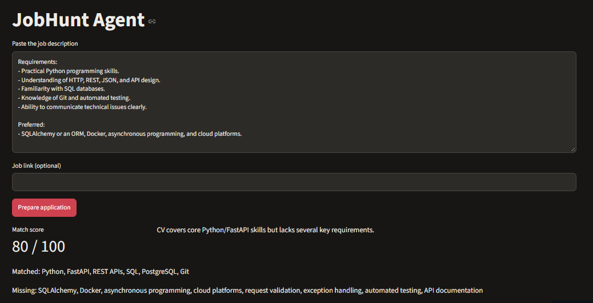
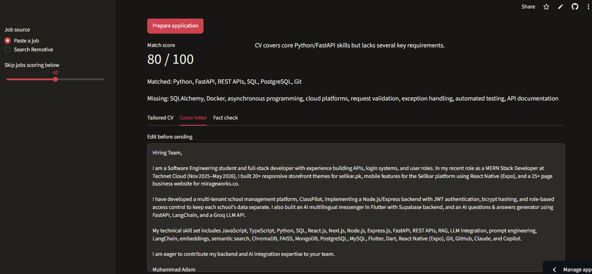
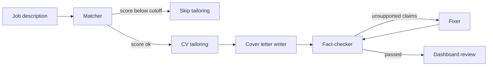

# JobHunt Agent


An AI agent that helps with the slowest part of job hunting: tailoring your application to every role. Paste a job description and it scores your CV match, tailors your CV, writes a cover letter, and runs a second AI agent that **fact-checks the letter against your real profile** before you see it.

**[Live demo](https://jobhunt-agent.streamlit.app/)** (uses a sample CV, limited to 3 runs per session)



## Features

- **Match scoring:** a 0 to 100 score with matched skills, missing skills, strengths, and a one-line reason.
- **CV tailoring:** a job-specific summary, skill order, top projects, and rewritten bullets. Facts stay the same, only emphasis changes.
- **Cover letter with a fact-check loop:** a writer agent drafts the letter, a checker agent flags unsupported claims, and a fixer agent revises it (max 2 rounds).
- **Job sources:** paste any job description (LinkedIn, Rozee, Indeed, or email) or search remote jobs through the Remotive API.
- **Score gate:** jobs below your cutoff skip the expensive steps to save API quota.
- **Human in the loop:** you review everything and click apply yourself on the original job site.



## How it works



### Guardrails against invented claims

Language models tend to add skills you never had. Each layer below catches a different kind of problem, and code-level checks back up the prompts.

| Layer | What it catches |
|---|---|
| Prompt rules | Instructs the model to use only facts from the profile |
| Skill whitelist (code) | Removes any tailored skill that is not in `profile.json` |
| Number check (code) | Flags figures that do not appear in the profile |
| Keyword check (code) | Flags tools or technologies the profile does not mention |
| LLM fact-checker | Flags subtler unsupported claims, such as invented responsibilities |

## Tech stack

- **Python 3.10+**
- **Groq API** with `openai/gpt-oss-20b` for inference
- **Streamlit** for the dashboard
- **Remotive API** for remote job listings
- **Streamlit Community Cloud** for free hosting

## Getting started

### 1. Install

```bash
git clone https://github.com/your-username/jobhunt-agent.git
cd jobhunt-agent
python -m venv venv
venv\Scripts\activate        # Windows
# source venv/bin/activate   # macOS/Linux
pip install -r requirements.txt
```

### 2. Add your API key

Get a free key at [console.groq.com](https://console.groq.com) and create a `.env` file:

```env
GROQ_API_KEY=your_key_here
```

### 3. Run in demo mode

```bash
streamlit run app.py
```

With no private files present, the app uses `cv_sample.txt` and `profile_sample.json`.

### 4. Run on your own CV

1. Save your CV as plain text in `cv.txt`.
2. Build your structured profile:
   ```bash
   python cv_parser.py
   ```
3. Open `profile.json` and correct anything the model got wrong. This file is the source of truth for every fact-check.
4. Start the app with `streamlit run app.py`.

### Command-line tools

| Command | What it does |
|---|---|
| `python match_cli.py jobs/job1.txt` | Match report for one job |
| `python batch.py` | Score every file in `jobs/` and export `results.csv` |
| `python tailor_cli.py jobs/job1.txt` | Tailored summary and skills |
| `python bullets_cli.py jobs/job1.txt` | Rewritten experience bullets |
| `python cover_cli.py jobs/job1.txt` | Cover letter without fact-checking |
| `python review_cli.py jobs/job1.txt` | Cover letter with the fact-check loop |

## Project structure

```
app.py              Streamlit dashboard
prepare.py          prepare_application(): runs the full pipeline
matcher.py          CV vs job scoring
cv_parser.py        CV text to structured profile.json
tailor.py           Summary, skills, and top projects
bullets.py          Bullet rewriting with number guard
cover_letter.py     Cover letter writer
fact_checker.py     Code and LLM fact-checks
safe_letter.py      Write, check, fix loop
llm.py              Shared LLM helpers with retry logic
tools.py            Job search and tool-calling experiments
agent_v1.py         Early tool-calling agent (being replaced by LangGraph)
cv_sample.txt       Sample CV for demo mode
profile_sample.json Sample profile for demo mode
```

## Privacy

`cv.txt`, `profile.json`, `jobs/`, `output/`, and `.env` are listed in `.gitignore` and never leave your machine. The public demo runs only on the sample CV.

## Limitations

- The fact-checker reduces invented claims but cannot guarantee zero. Always read the output before sending.
- The tool does not auto-apply. This is deliberate, since LinkedIn and similar sites restrict automation.
- Free API tiers are rate-limited, so heavy use may slow down or pause.
- Remotive lists remote jobs worldwide and is a small board. Job alert emails and pasted descriptions cover other sources.

## Roadmap

- [x] CV-to-job match scoring
- [x] Structured profile and CV tailoring
- [x] Cover letters with a fact-check loop
- [x] Streamlit dashboard with demo mode
- [x] Public deployment
- [ ] Gmail job-alert intake (LinkedIn, Rozee, Indeed)
- [ ] LangGraph multi-agent workflow
- [ ] Job tracker (applied, interview, rejected)
- [ ] Formatted PDF and Word export of the tailored CV
- [ ] One-click email applications

## What I learned

- Put guardrails in code, not only in prompts.
- Let the model make decisions and let code do the looping.
- Put retry logic in one shared helper so every agent benefits.
- When an agent misbehaves, print what its tools return before changing the prompt.

## Author

**Your Name** · [LinkedIn](https://linkedin.com/in/your-profile) · [GitHub](https://github.com/your-username)
